# 🧠 Deep Learning Laboratory — Neural Networks, Optimizers & CNNs

<p align="center">
  
</p>

<p align="center">
  An experimental deep learning laboratory repository covering foundational neural network mechanics, forward and backpropagation from scratch, loss landscape analyses, optimizer comparative dynamics (SGD, Momentum, RMSprop, Adam), and Convolutional Neural Networks (CNNs).
</p>

<p align="center">
  <a href="https://github.com/prakruthidevanga/Deep-Learning-">
    
  </a>
</p>

<p align="center">
  
  
  
  
</p>

---

## 📌 Table of Contents

- [📖 Project Overview](#-project-overview)
- [🎯 Objectives](#-objectives)
- [🔬 Laboratory Experiment Index](#-laboratory-experiment-index)
- [🏗️ Convolutional Neural Network Workflow](#️-convolutional-neural-network-workflow)
- [🛠️ Technology Stack](#️-technology-stack)
- [📁 Repository Structure](#-repository-structure)
- [⚙️ Installation and Setup](#️-installation-and-setup)
- [🔮 Future Enhancements](#-future-enhancements)
- [🤝 Contributing](#-contributing)
- [👩‍💻 Author & Accreditations](#-author--accreditations)

---

## 📖 Project Overview

Modern deep learning applications rely on solid understanding of how loss functions shape the parameter search space and how gradient descent navigates high-dimensional non-convex landscapes.

This repository documents the foundational mathematics and Python implementations of core Deep Learning principles developed during coursework at Alliance University. It transitions from analytical derivative calculations on paper to multi-layer perceptron forward propagation, comparative convergence analysis across 4 major optimizers, and computer vision classification using Convolutional Neural Networks.

🧠 **Core Mission:** Provide clear, mathematical, and reproducible implementations of core deep learning mechanics.

---

## 🎯 Objectives

- 📈 **Master Activation Dynamics:** Compare vanishing gradient behavior across Sigmoid, Tanh, ReLU, Leaky ReLU, and Softmax.
- 📉 **Evaluate Optimization Convergence:** Empirically assess training speed and oscillation across SGD, Momentum, RMSprop, and Adam.
- 🛡️ **Diagnose Generalization:** Mitigate overfitting using Dropout layers, $L_2$ weight regularization, and early stopping.
- 👁️ **Build Spatial Convolutions:** Implement convolutional feature extractors, filter strides, padding, and max-pooling for digit recognition.
- ⚖️ **Ethical AI Integration:** Formally assess bias, fairness, and ethical dilemmas in commercial deep learning systems.

---

## 🔬 Laboratory Experiment Index

| Experiment # | Asset / Notebook | Deep Learning Principle |
| :-: | :--- | :--- |
| **Project 5** | `PROJECT_5_ACTIVATION_FUNCTIONS_USING_PYTHON` | Mathematical gradients and output ranges of Sigmoid, Tanh, ReLU, Softmax |
| **Project 6** | `Project_6_Simple_Neural_Network_Forward_Propagation` | Multi-layer Perceptron (MLP) forward pass matrix operations |
| **Project 7** | `Project_7_Understanding_Loss_Functions_in_Neural_Networks` | Mean Squared Error (MSE), Binary Cross-Entropy, Multi-class Log Loss |
| **Project 8** | `Project_8_Gradient_Descent_Implementation` | Batch, Mini-Batch, and Stochastic Gradient Descent (SGD) |
| **Project 9** | `Project_9_Comparison_of_Optimizers_Using_a_Neural_Network` | Comparative trajectory analysis: SGD vs Momentum vs RMSprop vs Adam |
| **Project 10** | `Project_10_Overfitting_Underfitting_Assignment` | Bias-variance trade-off, learning curve diagnosis, and Dropout |
| **Project 11** | `Project_11_Handwritten_Digit_Recognition_Using_CNN` | End-to-end 2D CNN trained on the MNIST handwritten digit dataset |
| **Project 12** | `Project_12_Understanding_Convolution_and_Pooling` | Mathematical feature maps, filter kernels, strides, and pooling |
| **Theory** | `DL assignment project mathematical calculation .pdf` | Analytical derivative calculations and chain rule backprop proofs |
| **Ethics** | `ETHICAL CONSIDERATIONS IN DEEP LEARNING.pdf` | Algorithmic fairness, dataset representation, and explainability |

---

## 🏗️ Convolutional Neural Network Workflow

```mermaid
flowchart LR
    A["Raw 28x28 Grayscale Image (MNIST)"] --> B["2D Convolutional Layers (Filters / Kernels)"]
    B --> C["Activation Function (ReLU)"]
    C --> D["Max Pooling (Spatial Downsampling)"]
    D --> E["Flatten -> Dense Fully Connected Layer"]
    E --> F["Dropout (0.25 - 0.5 Regularization)"]
    F --> G["Softmax Layer (10 Digit Classes)"]
    G --> H["Cross-Entropy Loss & Adam Backprop Update"]
```



---

## 🛠️ Technology Stack

<p align="center">
  
</p>

| Component | Library / Framework | Implementation Details |
| :--- | :--- | :--- |
| **Deep Learning Frameworks** | TensorFlow / Keras, PyTorch | Model definition, autograd, and layer building |
| **Numerical Processing** | NumPy, SciPy | Matrix multiplications and custom activation functions |
| **Visualizations** | Matplotlib, Seaborn | Training loss curves and filter feature map visualizers |
| **Dataset Benchmarks** | MNIST Handwritten Digits | Standard multi-class classification benchmark |

---

## 📁 Repository Structure

```text
Deep-Learning-/
├── PROJECT_5_ACTIVATION_FUNCTIONS_USING_PYTHON_(DL) (1).ipynb
├── Project_6_Simple_Neural_Network_Forward_Propagation.ipynb
├── Project_7_Understanding_Loss_Functions_in_Neural_Networks_(DL).ipynb
├── Project_8_Gradient_Descent_Implementation_(DL).ipynb
├── Project_9_Comparison_of_Optimizers_Using_a_Neural_Network.ipynb
├── Project_10_Overfitting_Underfitting_Assignment.ipynb
├── Project_11_Handwritten_Digit_Recognition_Using_CNN.ipynb
├── Project_12_Understanding_Convolution_and_Pooling(DL) (1).ipynb
├── DL assignment project mathematical calculation .pdf
├── ETHICAL CONSIDERATIONS IN DEEP LEARNING (Assignment 4).pdf
└── README.md
```

---

## ⚙️ Installation and Setup

### Prerequisites
- Python 3.9+
- Jupyter Notebook or Google Colab

### Running the Experiments:
```bash
git clone https://github.com/prakruthidevanga/Deep-Learning-.git
cd Deep-Learning-
python -m venv .venv
.\.venv\Scripts\Activate.ps1
pip install tensorflow keras torch torchvision numpy matplotlib seaborn jupyter
jupyter notebook
```

---

## 🔮 Future Enhancements

- 🔄 **Recurrent Networks:** Add LSTM / GRU notebooks for sequential time-series prediction.
- 👁️ **ResNet & Transfer Learning:** Add pre-trained ResNet-50 feature extraction on custom datasets.

---

## 🤝 Contributing

Contributions and discussion are welcomed! Feel free to open an issue or pull request.

---

## 👩‍💻 Author & Accreditations

**Prakruthi B R**  
*BCA Student specializing in Artificial Intelligence & Machine Learning*  
*Alliance University, Bengaluru (CGPA: 9.60)*  
*GeeksforGeeks Campus Mantri (2026)*

- 💻 **GitHub:** [@prakruthidevanga](https://github.com/prakruthidevanga)
- 🔗 **LinkedIn:** [Prakruthi BR](https://linkedin.com/in/prakruthi-br)
- 🌐 **Portfolio:** [prakruthidevanga.github.io](https://prakruthidevanga.github.io/)
- 📬 **Email:** [prakruthibr2006@gmail.com](mailto:prakruthibr2006@gmail.com)

---

<p align="center">
  <b>🧠 Demystifying neural computation from first principles to modern vision architectures.</b>
</p>

<p align="center">
  
</p>
