# 🧠 Deep Learning Laboratory: Architectures, Optimizers & CNNs

A structured experimental laboratory repository covering fundamental to advanced Deep Learning concepts, neural network mechanics, backpropagation, optimization dynamics, regularization, and Convolutional Neural Networks (CNNs) completed at Alliance University.

---

## 📌 Repository Overview

This repository demonstrates rigorous mathematical understanding and practical Python implementations of deep learning fundamentals:
- **Activation Functions:** Mathematical properties, forward pass behavior, derivatives, and vanishing gradient comparisons across Sigmoid, Tanh, ReLU, Leaky ReLU, and Softmax.
- **Forward & Backpropagation:** From-scratch computation graphs, matrix operations, and chain rule differentiation.
- **Loss Landscapes & Cost Functions:** Mean Squared Error (MSE), Binary Cross-Entropy (BCE), and Categorical Cross-Entropy.
- **Optimization Algorithms:** Comparative convergence analysis across SGD, Momentum, RMSprop, and Adam.
- **Regularization & Generalization:** Diagnosing underfitting vs. overfitting through learning curves, Dropout, $L_1$/$L_2$ weight decay, and early stopping.
- **Convolutional Neural Networks (CNNs):** Feature extraction through spatial convolutions, kernel filtering, pooling layers, and end-to-end MNIST handwritten digit recognition.

---

## 📂 Laboratory Experiment Index

| Project # | Notebook / Asset | Core Deep Learning Concept |
| :-: | :--- | :--- |
| **Project 5** | `PROJECT_5_ACTIVATION_FUNCTIONS_USING_PYTHON` | Sigmoid, Tanh, ReLU, Leaky ReLU, Softmax & Gradients |
| **Project 6** | `Project_6_Simple_Neural_Network_Forward_Propagation` | Multi-Layer Perceptron (MLP) forward inference |
| **Project 7** | `Project_7_Understanding_Loss_Functions_in_Neural_Networks` | MSE, Binary Cross-Entropy, Multi-class Log Loss |
| **Project 8** | `Project_8_Gradient_Descent_Implementation` | Batch, Stochastic (SGD), and Mini-Batch Gradient Descent |
| **Project 9** | `Project_9_Comparison_of_Optimizers_Using_a_Neural_Network` | Comparative dynamics: SGD vs Momentum vs RMSprop vs Adam |
| **Project 10** | `Project_10_Overfitting_Underfitting_Assignment` | Bias-variance trade-off, Dropout, $L_2$ regularization |
| **Project 11** | `Project_11_Handwritten_Digit_Recognition_Using_CNN` | End-to-end CNN classifier trained on MNIST |
| **Project 12** | `Project_12_Understanding_Convolution_and_Pooling` | Mathematical feature maps, filter strides, padding, and max pooling |
| **Theory** | `DL assignment project mathematical calculation .pdf` | Analytical derivative calculations and backprop proofs |
| **Ethics** | `ETHICAL CONSIDERATIONS IN DEEP LEARNING (Assignment 4).pdf` | Algorithmic fairness, bias auditing, and model explainability |

---

## 🏗️ Neural Network Pipeline & CNN Hierarchy

```mermaid
flowchart LR
    A["Raw 2D Image / Vector Input"] --> B["Convolution Layers (Filters/Kernels)"]
    B --> C["Activation Function (ReLU)"]
    C --> D["Pooling Layer (Spatial Downsampling)"]
    D --> E["Flatten -> Fully Connected (Dense) Layers"]
    E --> F["Dropout (Regularization)"]
    F --> G["Softmax Output -> Cross-Entropy Loss"]
    G --> H["Optimizer (Adam/SGD Backprop Gradient Update)"]
```



---

## ⚙️ Installation & Usage

### Prerequisites
- Python 3.8+
- Jupyter Notebook or JupyterLab

### Running the Experiments:

1. **Clone the repository:**
   ```bash
   git clone https://github.com/prakruthidevanga/Deep-Learning-.git
   cd Deep-Learning-
   ```

2. **Install required dependencies:**
   ```bash
   pip install tensorflow keras torch torchvision numpy matplotlib seaborn scikit-learn jupyter
   ```

3. **Launch the notebook environment:**
   ```bash
   jupyter notebook
   ```

---

## 🛠️ Technology Stack

- **Deep Learning Frameworks:** TensorFlow / Keras, PyTorch
- **Scientific Computing:** NumPy, Pandas
- **Visualization:** Matplotlib, Seaborn
- **Environment:** Jupyter Notebook, Google Colab

---

## 👩‍💻 Author & Contributions

- **Author:** Prakruthi B R ([@prakruthidevanga](https://github.com/prakruthidevanga))
- **Program:** BCA (Specialization in Artificial Intelligence and Machine Learning), Alliance University.
- **Contributions:** Implemented all neural network forward passes, optimizer comparison experiments, CNN classification pipelines, and mathematical derivative derivations.
